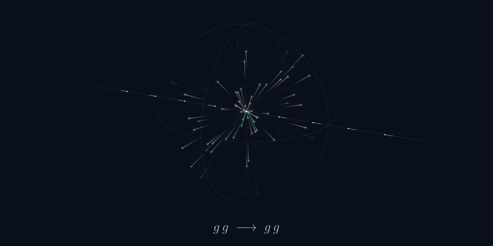

# floops

Scattering amplitudes, particle decays and Feynman diagrams, computed in Rust. Thin Python bindings provide access to the same engine; a Three.js viewer animates its results.



2.784 trillion weighted events, 20 minutes of GPU time, 91.9 GiB of resident event data. The animation shows sampled momenta and statistics from the complete run. [Measurements and reproduction](benchmarks/GPU.md) · [Rust CUDA Oxide backend](docs/GPU.md).

| Experiment | Implemented physics |
| --- | --- |
| Scattering | Nine massless tree-level QED/QCD channels, parallel weighted events, differential cross sections and Monte Carlo errors |
| Decays | 44 catalogue entries, 20 decaying species, two/three-body phase space, unpolarized leptonic V−A decays, recursive chains and lifetimes |
| Amplitudes | Complex 4–12 gluon MHV amplitudes; explicit four-gluon SU(3) color/helicity sums |
| Diagrams | Process-linked SVG diagrams and exhaustive 3–6 gluon tree topologies |
| SU(3) lattice | Periodic 4D pure-gauge Wilson action, parallel Markov chains, plaquettes, Wilson and Polyakov loops |

This is an experimental, bounded physics toolkit. It does not implement full Standard Model event generation, showers, hadronization, loop amplitudes, dynamical lattice quarks, or real-time QCD. See [physics and validation](docs/PHYSICS.md).

## Python

Python 3.10+; calculations run in native Rust, with Rayon for parallel batches. The initial package release targets PyPI; crates.io publication is deferred.

```sh
pip install floops
```

```python
import json
import floops

result = json.loads(floops.scatter('{"events":100000,"seed":42}'))
print(result["cross_section_pb"], result["standard_error_pb"])

decays = json.loads(floops.decay('{"pdg":13,"events":1000,"display":4}'))
diagrams = json.loads(floops.diagrams('{"process":"gluon_gluon"}'))
```

Bindings accept and return JSON strings. Invalid requests raise `ValueError`. Wheels bundle the native backend; building from source requires Rust. [API](docs/API.md) · [validation](docs/VALIDATION.md).

## 3D viewer and Rust development

The viewer and CLI run from this repository. Requires Rust, Node.js 22.12+ and npm.

```sh
git clone https://github.com/su3co/floops.git
cd floops
npm ci --prefix web
npm run build --prefix web
cargo run --release -p floops-cli -- serve
```

Open **http://127.0.0.1:8631**. Calculations run in Rust; the browser renders a bounded sample and displays statistics from the entire batch. Animation is controlled with Play and the timeline. JSON, CSV and SVG exports are available.

## Development commands

```sh
cargo run --release -p floops-cli -- scatter --input examples/scatter.json
cargo run --release -p floops-cli -- lattice --input examples/lattice.json
cargo run --release -p floops-cli -- benchmark --events 5000000
cargo test --release -p floops
```

Build the Python extension locally with `pip install .`, then run `python examples/python_smoke.py`. The wrapper releases Python while Rust computes. All physics lives in Rust.

[Release guide](docs/RELEASING.md) · [Benchmark](benchmarks/README.md) · [MIT](LICENSE).
