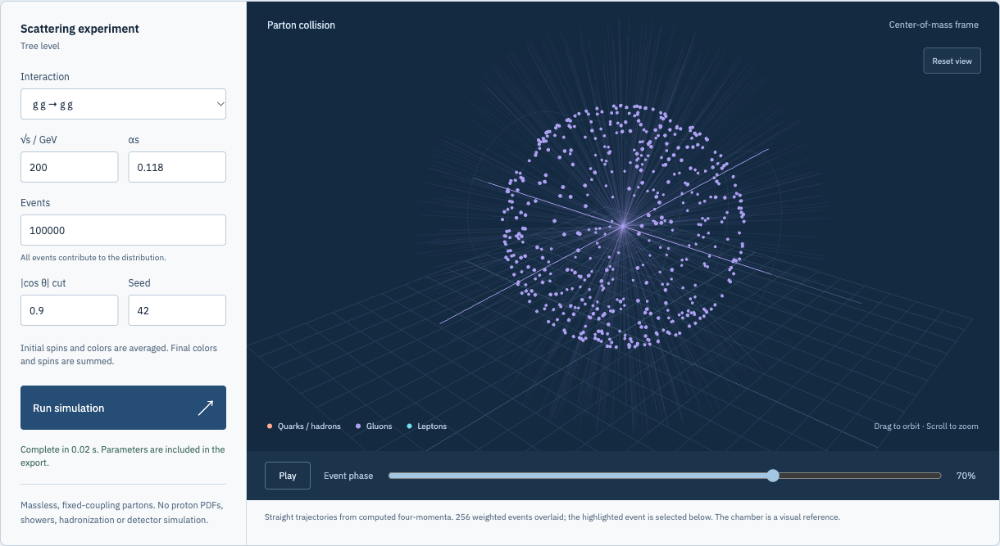

# unnamed

A Rust laboratory for particle decays, scattering amplitudes and SU(3) gauge fields, with an interactive Three.js viewer and small Python bindings. Temporary name: `feynman` is already registered on PyPI.

| Experiment | Implemented physics |
| --- | --- |
| Scattering | Nine massless tree-level QED/QCD channels, parallel weighted events, differential cross sections and Monte Carlo errors |
| Decays | 44 catalogue entries, 20 decaying species, two/three-body phase space, unpolarized leptonic V−A decays, recursive chains and lifetimes |
| Amplitudes | Complex 4–12 gluon MHV amplitudes; explicit four-gluon SU(3) color/helicity sums |
| Diagrams | Process-linked SVG diagrams and exhaustive 3–6 gluon tree topologies |
| SU(3) lattice | Periodic 4D pure-gauge Wilson action, parallel Markov chains, plaquettes, Wilson and Polyakov loops |

This is an experimental, bounded physics toolkit. It does not implement full Standard Model event generation, showers, hadronization, loop amplitudes, dynamical lattice quarks, or real-time QCD. See [physics and validation](docs/PHYSICS.md).



## Run

Requires Rust, Node.js 22.12+ and npm. Python is optional.

```sh
cd web
npm ci
npm run build
cd ..
cargo run --release -p unnamed-server -- serve
```

Open **http://127.0.0.1:8631**. Calculations run in Rust; the browser renders a bounded sample and displays statistics from the entire batch. Animation is controlled with Play and the timeline. JSON, CSV and SVG exports are available.

## CLI and Python

```sh
cargo run --release -p unnamed-server -- scatter --input examples/scatter.json
cargo run --release -p unnamed-server -- lattice --input examples/lattice.json
cargo run --release -p unnamed-server -- benchmark --events 5000000
cargo test --release -p unnamed-physics
```

Optional Python bindings:

```sh
python -m venv .venv
# Activate .venv, then:
pip install .
python examples/python_smoke.py
```

```python
import json
import unnamed_physics as physics

result = json.loads(physics.scatter(json.dumps({"events": 1000000, "seed": 42})))
print(result["cross_section_pb"], result["standard_error_pb"])
```

The wrapper releases Python while Rust computes. All physics lives in Rust. No package has been published to PyPI. [API and extension guide](docs/API.md) · [benchmark](benchmarks/README.md) · [MIT license](LICENSE).
